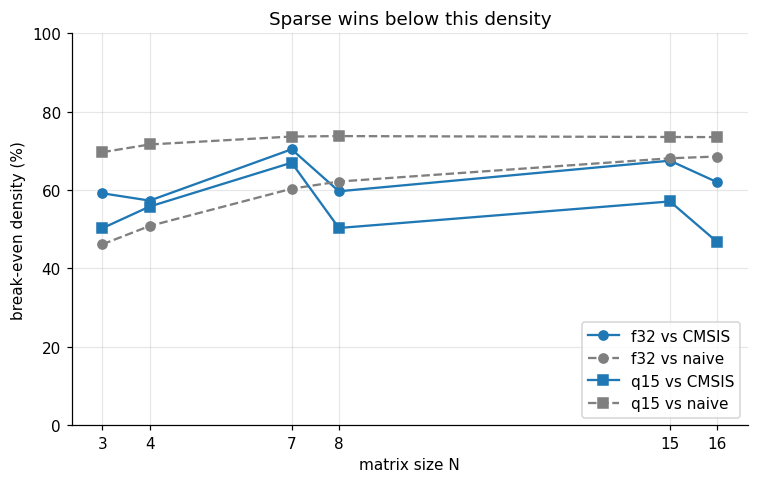

# Cortex-M4 matrix multiplication benchmark: naive vs CMSIS-DSP vs sparse (CSC)

A small benchmark that compares three ways to compute `C = A · B` on a Cortex-M4 — specifically the **FRDM-K64F** board (MK64FN1M0) — with `A` dense and `B` sparse, both `N × N`:

| Kernel | Description |
|---|---|
| **naive** | Plain triple loop, compiled with `-O2` |
| **CMSIS-DSP** | `arm_mat_mult_f32` / `arm_mat_mult_q15`. To keep the comparison fair, `B` is transposed *before* the call, so only the multiplication itself is timed (the stock CMSIS q15 path transposes internally) |
| **sparse (CSC)** | Custom kernel that walks `B` stored in CSC (compressed sparse column) format |

The goal is to answer a practical question for embedded work: **how sparse does a matrix have to be before a custom CSC kernel beats a well-optimized dense library on a small MCU?** The dense-to-CSC conversion is done **outside** the timed region, so the numbers describe *static* sparsity (e.g. a constant, pruned weight matrix).

### Methodology

- Data types: `float32` and `q15`
- Sizes: `N = 3, 4, 7, 8, 15, 16` (small kernels, typical of control loops and tiny NN layers)
- Non-zero count (NZ) of `B` is fixed per test case and swept to vary density
- Inputs are regenerated randomly on every iteration
- Reported: average, min and max cycle counts over the iterations
- Raw output captured from the board: [`results.txt`](results.txt)

## Results summary

The full analysis (break-even fits, cycles/MAC, variability, parity effects, …) is in
[`matmul_benchmark_analysis.ipynb`](matmul_benchmark_analysis.ipynb), which runs on the committed
`results.txt` without any hardware.

- **Sparse cost is ~linear in NZ**, while the dense kernels cost is constant per size and scales with `N³`.
  Hence the sparse advantage at low density grows with `N` (up to **~6.9× vs CMSIS for f32** and
  **~5.2× for q15** at the lowest measured NZ, both at `N = 15`).
- **Sparse stops winning around 50–70 % density.** Break-even densities obtained by fitting
  `cycles = a + b·NZ` and intersecting with the dense cost:

  | N | f32 vs CMSIS | f32 vs naive | q15 vs CMSIS | q15 vs naive |
  |---|--------------|--------------|--------------|--------------|
  | 3  | 59 % | 46 % | 50 % | 70 % |
  | 4  | 57 % | 51 % | 56 % | 72 % |
  | 7  | 70 % | 60 % | 67 % | 74 % |
  | 8  | 60 % | 62 % | 50 % | 74 % |
  | 15 | 67 % | 68 % | 57 % | 74 % |
  | 16 | 62 % | 69 % | 47 % | 73 % |

  Below the break-even, sparse is faster; above it, the dense kernel wins. Values are accurate to about
  ±5 density points because of the coarse NZ grid.

- **Naive vs CMSIS:** for `f32`, the naive loop is actually *faster* for `N = 3, 4, 7`; CMSIS only pulls
  ahead from `N = 8`, where the loop-unrolling/SIMD gains finally amortize the remainder/tail handling
  (`arm_mat_mult_f32` unrolls 4 MACs per iteration). For `q15`, CMSIS wins at every measured size.
- **Power-of-two sizes matter:** CMSIS gains are much larger going from 7 → 8 and 15 → 16 (SIMD pairs and
  unrolling), while the naive kernel follows only the general `N` trend.
- **Sparse cycles/MAC are much higher than dense (for low desity)** (>100 vs ~10–25 cycles/MAC), but since there are far
  fewer MACs to perform, the total cost is still lower (at low density).
- **Variability:** dense kernels are deterministic (`min = max`); sparse spread comes from random non-zero
  placement. Random layouts do not cover adversarial cases (e.g. all non-zeros in one column), so these are
  **not** WCET bounds.

### When does sparse win? (illustrative figure)



Each curve is the density at which the sparse CSC kernel becomes more expensive than the corresponding
dense kernel. Everything below a curve is "sparse wins", everything above is "dense wins". The gap between
the solid (vs CMSIS) and dashed (vs naive) curves shows how much the choice of dense baseline matters:
for `f32`, naive is the tougher opponent at small `N`; for `q15`, CMSIS is.

## Explore / replay the data in Colab

[](https://colab.research.google.com/github/thiagoton/cortex-m4-sparse-matrix-benchmark/blob/main/matmul_benchmark_analysis.ipynb)

The notebook only needs `results.txt`. In Colab, either clone the repo or upload your own `results.txt`
to the session (the notebook looks for it in `./` and `./data/`), then run all cells to regenerate every
figure and the summary tables.

## Building

### Prerequisites

- [ARM GNU Toolchain](https://developer.arm.com/downloads/-/arm-gnu-toolchain-downloads) (`arm-none-eabi-gcc`, tested with 14.2.rel1)
- CMake ≥ 3.14 and Ninja
- Python 3 (for `make.py`)

The toolchain is located through the `ARMGCC_DIR` environment variable, and the CMake presets pull their
environment from `mcux_include.json` (not committed). Create it next to `CMakePresets.json`, adjusting the
paths to your installation:

```json
{
  "version": 7,
  "cmakeMinimumRequired": { "major": 3 },
  "configurePresets": [
    {
      "name": "debug-env",
      "hidden": true,
      "environment": {
        "ARMGCC_DIR": "C:/path/to/arm-gnu-toolchain-14.2.rel1-mingw-w64-x86_64-arm-none-eabi",
        "PATH": "${env:ARMGCC_DIR}/bin${pathListSep}${env:PATH}"
      }
    },
    {
      "name": "release-env",
      "hidden": true,
      "environment": {
        "ARMGCC_DIR": "C:/path/to/arm-gnu-toolchain-14.2.rel1-mingw-w64-x86_64-arm-none-eabi",
        "PATH": "${env:ARMGCC_DIR}/bin${pathListSep}${env:PATH}"
      }
    }
  ]
}
```

Alternatively, export `ARMGCC_DIR` yourself and configure with the same preset names.

### Build the firmware

```sh
# optional: pre-build CMSIS-DSP as a standalone static library
python make.py build_dsp --build-type release

# build the firmware (also builds CMSIS-DSP through ExternalProject)
python make.py build --build-type release
```

The ELF is produced at `_deploy/release/benchmark.elf`, together with a source-intermixed
`benchmark.elf.disasm`. For a debug build use `--build-type debug`.

### Flash and capture results

1. Connect the FRDM-K64F over the OpenSDA USB port.
2. Flash `_deploy/<build-type>/benchmark.elf` with the MCUXpresso VS Code debug configuration
   (Linkserver/SEGGER) or your usual `arm-none-eabi-gdb` flow.
3. Open a serial terminal at **115200 8N1, no flow control**, let the benchmark run, and save the output
   as `results.txt` in the repo root.
4. Re-run the notebook (or the Colab link above) to refresh the figures and summary.

### Other make targets

```sh
python make.py build_all            # debug + release
python make.py clean                # remove _build/ and _deploy/
```

## Project layout

```
matmul_benchmark_analysis.ipynb  analysis notebook (no hardware needed)
results.txt                      raw cycle counts captured from the board
figures/                         generated plots embedded in this README
src/test_suites/                 benchmark kernels and test drivers
src/CMSIS/DSP/                   vendored CMSIS-DSP sources
cmake/cmsis-dsp/                 standalone CMSIS-DSP build
cmake/                           toolchain and MCUXpresso SDK modules
ld/, doc/                        linker script and SDK docs
make.py, CMakePresets.json       build entry points
```

## Limitations

- **Coarse NZ grid:** break-evens are accurate to about ±5 points of density.
- **Sweep does not reach 100 % density** for some sizes (largest NZ < N² for `N = 4, 15, 16`).
- **Static sparsity only:** CSC conversion is not timed; add its cost if `B` changes at runtime.
- **Small matrices only:** up to `N = 16`; trends may differ for larger `N`.
- **Random placement only:** structured patterns (banded, block, diagonal) are not covered.


